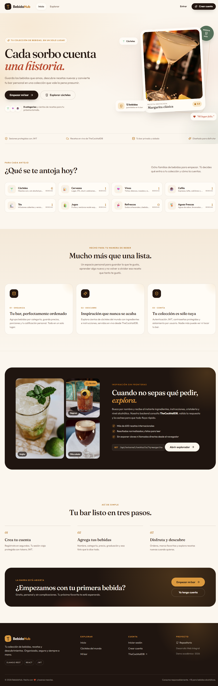

# BebidaHub

Aplicación web para llevar un registro personal de bebidas. Permite guardar bebidas, organizarlas por categoría, marcarlas como favoritas y buscar cócteles en TheCocktailDB.

Lo hice como proyecto individual de Desarrollo Web Integral.



## Qué incluye

- Registro e inicio de sesión con JWT.
- Página "Mi bar" con las bebidas del usuario. Cada cuenta ve solo sus propios datos.
- Crear, editar y eliminar bebidas desde un formulario modal.
- Búsqueda, filtro por categoría, filtro de favoritas, ordenamiento y paginación.
- Estadísticas del bar: total de bebidas, favoritas, categorías y ABV promedio.
- Página "Explorar" con datos de TheCocktailDB.
- Diseño adaptable a computadora y celular.

## Tecnologías

- Frontend: React 19, Vite 6, React Router 7, Axios y lucide-react.
- Backend: Django 5.2, Django REST Framework 3.18 y SimpleJWT.
- Base de datos: SQLite para la demo.
- API externa: TheCocktailDB.
- Pruebas: Django APITestCase y coverage.py.

## Instalación

Necesitas Python 3.12 o superior, Node.js 20 o superior y npm 10 o superior.

### Backend

```powershell
cd backend
python -m venv .venv
.\.venv\Scripts\Activate.ps1
pip install -r requirements-dev.txt
Copy-Item .env.example .env
```

Genera una clave secreta y pégala en `DJANGO_SECRET_KEY` dentro de `backend/.env`:

```powershell
python -c "import secrets; print(secrets.token_urlsafe(64))"
```

Después:

```powershell
python manage.py migrate
python manage.py seed_demo
python manage.py runserver 127.0.0.1:8000
```

En Linux o macOS, crea el entorno con `python3 -m venv .venv` y actívalo con `source .venv/bin/activate`.

### Frontend

En otra terminal:

```powershell
cd frontend
npm install
Copy-Item .env.example .env
npm run dev
```

Abre <http://127.0.0.1:5173>.

Si el puerto 5173 está ocupado, cierra el proceso que lo esté usando. También puedes cambiar el puerto, pero entonces agrega el nuevo origen en `CORS_ALLOWED_ORIGINS`.

## Cuenta de prueba

- Correo: `demo@bebidahub.com`
- Contraseña: `MangoPicante#42`

El comando `seed_demo` crea esa cuenta con 12 bebidas. En la pantalla de login hay un botón para entrar directo con ella.

## API

La API corre en `http://127.0.0.1:8000/api`.

Autenticación:

- `POST /auth/register/`
- `POST /auth/login/`
- `POST /auth/refresh/`
- `POST /auth/logout/`
- `GET` y `PATCH /auth/me/`

Bebidas:

- `GET` y `POST /beverages/`
- `GET`, `PUT`, `PATCH` y `DELETE /beverages/{id}/`
- `GET /beverages/stats/`

Categorías:

- `GET /categories/`

API externa:

- `GET /external/cocktails/?q=margarita`
- `GET /external/cocktails/random/`

Ejemplo de login:

```bash
curl -X POST http://127.0.0.1:8000/api/auth/login/ \
  -H "Content-Type: application/json" \
  -d '{"email":"demo@bebidahub.com","password":"MangoPicante#42"}'
```

La respuesta incluye un `access` que se envía en el encabezado `Authorization: Bearer <token>`.

## Modelos

`Category` tiene nombre, slug, descripción, icono y orden. Es global y solo se lee.

`Beverage` tiene propietario, categoría, nombre, descripción, precio, ABV, mililitros por porción, calificación, si es alcohólica, si es favorita, URL de imagen y fechas de creación y actualización.

Cada bebida pertenece a un usuario. Las consultas se filtran por el usuario autenticado, así que no se pueden ver ni modificar bebidas de otra cuenta. Las categorías no se pueden borrar si tienen bebidas.

## Pruebas

```powershell
cd backend
.\.venv\Scripts\python.exe manage.py test
```

Son 39 pruebas con 88 % de cobertura sobre `apps` y `config`. El detalle está en `docs/Reporte_de_Pruebas.pdf`.

## Seguridad

- La clave secreta se lee de `.env` y no se sube al repositorio.
- JWT con access de 30 minutos, refresh de 1 día, rotación y blacklist.
- Validación de longitudes, rangos, correos, URLs y rechazo de HTML.
- CORS con lista de orígenes permitidos.
- Límite de peticiones para login, registro y API externa.
- Configuración de producción con HTTPS, HSTS, cookies seguras y cabeceras defensivas.
- `check --deploy` sin advertencias.
- `pip-audit` y `npm audit` sin vulnerabilidades conocidas.

El reporte completo está en `docs/Reporte_de_Seguridad.pdf`.

## Estructura

```text
backend/    API en Django
frontend/   aplicación en React
docs/       PDFs, capturas y evidencia
scripts/    generación de evidencia y reportes
```

## Documentos

- Capturas de pantalla: `docs/Capturas_de_pantalla.pdf`
- Reporte de seguridad: `docs/Reporte_de_Seguridad.pdf`
- Reporte de pruebas: `docs/Reporte_de_Pruebas.pdf`

Si necesitas regenerarlos:

```powershell
cd backend
.\.venv\Scripts\python.exe ..\scripts\collect_evidence.py
.\.venv\Scripts\python.exe ..\scripts\generate_reports.py
```

## Autor

Héctor Hernández

GitHub: [@Hector9229](https://github.com/Hector9229)

Repositorio: <https://github.com/Hector9229/bebidahub>

Proyecto de Desarrollo Web Integral, 2026.

Beber con moderación. Solo mayores de 18 años.
